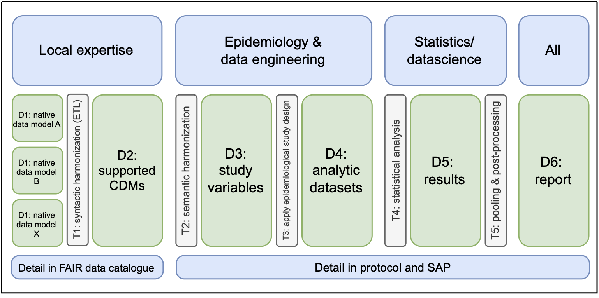

# TARGET-EU CASE STUDY 10: Clinical benefit of bevacizumab in metastatic colorectal cancer

This repository contains code which implements [case study 10](https://catalogues.ema.europa.eu/node/4900/administrative-details) of the [TARGET-EU project: Comparative effectiveness and safety studies using the target trial emulation and estimand frameworks](https://catalogues.ema.europa.eu/node/4440/administrative-details). The repository contains the code which implements the study design of this case study, along with documentation of that code, and where feasible, dummy data which allows users to run and understand the code. Below we describe briefly the case study and document the repository and its operation.

## Background

The acceptance of bevacizumab in mCRC treatment landscape varies largely throughout the Netherlands, presumably due to differences in policy and attitude​. This study will evaluate the comparative effectiveness of first-line addition of bevacizumab to the capecitabine-oxaliplatin (CapOx) regimen versus the CapOx regimen alone, in initially unresectable mCRC patients.

Primary Objective: Assess progression-free survival (PFS) in patients with mCRC when treated with CapOx-B compared with CapOx alone.

### EMA Catalogue Entries

[Catalogue Entry of Case Study](https://catalogues.ema.europa.eu/node/4900/administrative-details)

[Protocol & Report](https://catalogues.ema.europa.eu/node/4900/study-documents)

## Repository

This repository contains all code necessary to reproduce the results contained in the case study report, that is, the analytic pipeline designed to implement the specific study design. The repository does not contain any real data: The real data remains on secure servers, and only fictitious dummy data is shared here for testing, development and illustration purposes.

The analytic pipeline is conceptualised as a series of transformations (denoted "T") which transform data objects ("D") to other data objects [Gini et al. 2016](https://pmc.ncbi.nlm.nih.gov/articles/PMC4780748/)



The exact analytic pipeline for this study is represented as a graph containing specific data objects and transformation and their relationships [here](https://github.com/target-roc19/case-study-10-coloncancer-public/blob/main/docs/cs10_pipeline_target.drawio.png)

Each data object in the pipeline is documented in a corresponding **codebook** which describes how the data object is obtained from its inputs. Thereby, the codebooks specify the implementation of the given study design, which is executed by the scripts in the repository.

### Repository Structure

```         
[case-study-10-coloncancer]
|____configuration
|____data
| |____D2_cdm
| |____D3_study_variables
| |____D4_analytic_datasets
| |____D5_results
| |____D6_report
|____docs
|____logs
|____run
|____tests
|____transformations
| |____T2_semantic_harmonization
| |____T3_study_design
| |____T4_statistical_analysis
| |____T5_processing_results
|____CHANGELOG.md
|____LICENSE
|____README.md
```

- The `data/D2_cdm` folder contains the base input data, following a Common Data Model (CDM) structure, in this case the OMOP CDM.
- The `transformations` folder contains the scripts which compose the analytic pipeline
- Intermediate data objects created by `transformations` are stored in the other `data` subfolders
- The `docs/codebook` folder contains the study codebooks describing each intermediate data object
- The `transformations/common_configuration/RWE-BRIDGE` folder contains all project metadata, including events, medicines and vaccine codelists used in the study, as well as other metadata files specifying definitions of study concepts and variables.

### Codelist

The analysis pipeline uses a `codelist` to identify records in the source data relevant to the study objectives. This codelist, its authors, and the appropriate citation has its own DOI: [10.5281/zenodo.21219479](https://doi.org/10.5281/zenodo.21219479)


### Dummy Data

A synthetic CDM instance designed for this case study is available from [here](https://doi.org/10.5281/zenodo.24138065) in the form of parquet files following the OMOP CDM. The data was created using [Synthea](https://github.com/synthetichealth/synthea) and the Synthea-to-OMOP ETL developed by OHDSI [here](https://github.com/ohdsi/etl-synthea). Code to produce this data available on request

In addition to testing with the synthetic CDM, test data for a number of intermediate data objects can be found in `tests/testthat/test_data`

### How to Run

1.  Download the synthetic CDM instance found [here](https://doi.org/10.5281/zenodo.24138065).
2.  Unzip the folder and place in `data/D2_cdm`
3.  Ensure that in `configuration/config_project.yaml` the `data_instance` entry points to the folder with the synthetic data parquet files

```         
DEAP_configuration:
  data_instance: data/D2_cdm/OMOP_NKR_CS10
```

4.  Check that in `configuration/confg_t2.yaml` the step converting a postgresql database to parquet is skipped, allowing you to use the input parquet files

```         
substep:
  prepare_db_omop: false
```

5.  Run the full pipeline, following `renv` prompts, with:

```         
run/run_pipeline.R
```


Note:
- Which parts of the pipeline are executed can be configured through `configuration/config_pipeline.yaml`
- More specifically which scripts are executed in each part can be configured through `configuration/config_TX.yaml`.
- `config_project.yaml` defines which objects along which paths are used as inputs to different scripts in the pipeline, including the input CDM instance.
- To run specific steps of the pipeline, use `run/run_TX.r`

## License

See [License](https://github.com/target-roc19/case-study-10-coloncancer-public/blob/main/LICENSE.txt)

## Contact
For questions or support, contact:
- Case Study Lead
    - Name: Julia van Dommelen
    - Email: J.E.M.vanDommelen@umcutrecht.nl
- Programming Lead
    - Organisation: University Medical Center Utrecht 
    - Email: wp2.targeteu@umcutrecht.nl
